<p align="center">
  <a href="https://hbk.me"></a>
</p>

<p align="center">
  <a href="https://hbk.me"></a>
  <a href="https://thehbk.com"></a>
  <a href="https://ta7hbk.com"></a>
  <a href="https://t.me/hasanbahadirkoca"></a>
</p>

### `// 01 — HAKKIMDA · ABOUT`

Geceleri kod yazan, gündüz gökyüzünde uçan, her daim sular altında dolaşan, frekanslarda sinyal kovalayan; motorla toprak yollara, tırla uzun yollara, tekneyle denize açılan bir mühendis. Tek bir alana sığmayan, sadece meraklı bir insan.<br>
<sub>🇬🇧 An engineer who writes code at night, flies by day, spends his spare time underwater and chases signals across the bands — and takes to dirt roads on a motorcycle, long hauls in a truck and open water in a boat. Not one thing — just a curious person.</sub>

```yaml
isim / name:         Hasan Bahadır KOCA
unvan / title:       Bilgisayar Mühendisi · Computer Engineer (BAU)
çağrı / callsign:    TA7HBK
uçuş / flying:       Pilot
dalış / diving:      CMAS ★★
ilk yardım / aid:    TCCC
yol / road:          Motorcu · Motorcyclist (enduro) · Tır şoförü · Truck driver
deniz / sea:         Amatör denizci · Amateur sailor
şu an / now:         TheHBK — hosting, e-posta/e-mail, santral/PBX, mobil/mobile
```

### `// 02 — PROJELER · PROJECTS`

| | Proje · Project | Ne yapar · What it does |
|---|---|---|
| 🛰️ | **[TheHBK](https://thehbk.com)** | Web, mobil ve özel sistemler · sunucu, hosting, ağ, IoT<br><sub>Web, mobile & custom systems · servers, hosting, networking, IoT</sub> |
| ✉️ | **[e-Posta](https://eposta.app)** | Kurumsal e-posta altyapısı<br><sub>Business e-mail hosting</sub> |
| ☎️ | **[Santral](https://santral.app)** | IP PBX telefon sistemleri<br><sub>IP PBX phone systems</sub> |
| 🕌 | **[Vakitler](https://vakitler.tr)** | Namaz vakitleri — [App Store](https://apps.apple.com/tr/app/id6825107035)<br><sub>Prayer times app</sub> |
| 🔢 | **[Sudokify](https://sudokify.tr)** | Tarayıcıda sudoku<br><sub>Sudoku in the browser</sub> |
| 🐊 | **[Crocco](https://crocco.tr)** | 4 kişilik mini oyunlar<br><sub>Four-player mini games</sub> |
| 📡 | **[aprs.ai](https://aprs.ai)** · **[callbook.tr](https://callbook.tr)** · **[locator.tr](https://locator.tr)** | Türkiye APRS ağı, çağrı işareti rehberi, Maidenhead locator<br><sub>Türkiye's APRS network, callsign directory, Maidenhead locator</sub> |

**Açık kaynak · Open source:** [macTouchScreen](https://github.com/hasanbahadirkoca/macTouchScreen) · [plutosky_pinout](https://github.com/hasanbahadirkoca/plutosky_pinout) · [wireguard-install](https://github.com/hasanbahadirkoca/wireguard-install) · [metar-fetcher](https://github.com/hasanbahadirkoca/metar-fetcher) · [tssf-api](https://github.com/hasanbahadirkoca/tssf-api)

### `// 03 — ARAÇLAR · TOOLBOX`

<p>
  
</p>

Proxmox · ZFS · WireGuard · Tailscale · BunkerWeb · CrowdSec · Stalwart · Asterisk · LoRa / APRS · SDR

### `// 04 — DİSİPLİNLER · DISCIPLINES`

`💻 yazılım · software` `📻 amatör telsiz · ham radio` `🛩️ uçuş · flying` `🤿 dalış · diving` `🏍️ motorcu · motorcyclist (enduro)` `🚛 tır şoförü · truck driver` `🔌 elektronik · electronics & IoT` `⛑️ TCCC` `⛵ amatör denizci · amateur sailor` `🧭 seyahat · travel`

---

<p align="center"><sub><code>73 &amp; YOLUN AÇIK OLSUN · GÖKLERİN MAVİ · DENİZİN DURGUN</code><br><i>73 — clear roads, blue skies, calm seas</i></sub></p>
